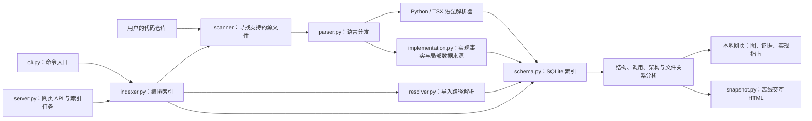

# CodeAtlas：从项目架构到文件实现

CodeAtlas 是本地代码分析工具。它把 Python / TypeScript / JavaScript 源文件转换成 SQLite 中的结构索引，再把可确认的关系显示成图和实现指南。它无需模型 API，也不会把源码发送到云端。

## 整体架构

下图说明实际职责和处理阶段。网页里的 Architecture 图则直接根据索引按目录分组，图上的每条依赖都有代码证据。阶段图与目录依赖图解释的是不同问题。



## 一次索引究竟做了什么

1. `index_project()` 先扫描仓库并计算文件内容的 SHA-256。增量模式同时检查文件是否已有实现事实，避免旧索引因为内容未变而漏掉新功能。
2. `parse_file()` 根据扩展名选择 Python 或 TSX 语法。解析器给出声明、导入和调用位置；`extract_implementation()` 另外提取参数、注释、返回表达式、控制结构及表达式之间的传递关系。
3. 解析成功后才替换旧数据。第一轮写入文件、声明、调用和 JSON 格式的实现事实，取得 SQLite ID；第二轮再用完整的文件 ID 映射解析导入与依赖。
4. 查询时按声明 ID 和明确的导入绑定连接调用。参数和局部赋值可能遮蔽导入名称，这种情况不强行选择一个同名目标。
5. 页面按模块或文件聚合关系。点击箭头查看调用行、生产者、消费者、参数位置与协调这次传递的函数。

## 核心文件的具体作用

| 文件 | 具体职责与实现要点 |
|---|---|
| `codeatlas/cli.py` | Click 命令入口。`index` 建立索引，`app` 启动网页，`snapshot` 导出交互页面。查询连接采用上下文管理，避免拼错项目名时创建空数据库。 |
| `codeatlas/config.py` | 管理数据目录、项目名、语言扩展名和排除目录。项目名经过清洗，多个仓库各有独立数据库。 |
| `codeatlas/scanner/scanner.py` | 遍历仓库并排除依赖、构建产物等目录，只交付支持的源文件。不会把图片、配置文件伪装成解析成功的代码文件。 |
| `codeatlas/indexer/indexer.py` | 扫描、哈希、增量判断、解析、两轮数据库插入的总编排。收集逐文件错误；全部解析失败时保留原有可用索引。导入关系在增量模式下也会重建，因为目标文件可能变化。 |
| `codeatlas/indexer/parser.py` | 语言分发与结果标准化。给导入补齐可选字段，并把实现事实加入解析结果，供存储层统一处理。 |
| `codeatlas/indexer/py_parser.py` | 使用 Python Tree-sitter 语法提取函数、类、方法、导入和调用位置。记录父声明及相对导入层数；解析器实例按线程隔离。 |
| `codeatlas/indexer/ts_parser.py` | 使用 TSX 语法处理 TS/JS/JSX。提取命名、默认、命名空间和再导出导入，以及函数、类型、类和箭头函数。作用域栈区分顶层声明与局部变量。 |
| `codeatlas/indexer/resolver.py` | 以导入方文件所在目录解析相对路径，支持 tsconfig 路径别名、JSONC 配置与 Python 点分模块。解析失败和外部包不会被强行连到项目中的同名文件。 |
| `codeatlas/storage/schema.py` | 定义 SQLite 表与索引，维护版本及外键。新增的 `file_analyses` 表与文件关联存储实现事实；删除文件时一并清理。 |
| `codeatlas/storage/queries.py` | 文件、声明、导入、依赖、统计等查询。UI 与 CLI 读取同一套索引。 |
| `codeatlas/analysis/structure.py` | 生成目录 / 声明树和按声明 ID 区分的调用图。按明确的本地或导入名称解析；成员和动态调用保留为未解析节点。 |
| `codeatlas/analysis/implementation.py` | 在索引时遍历 AST，提取函数文档、参数、控制结构和调用参数。用局部来源映射跟踪直接调用的结果、简单变量别名和嵌套调用；覆盖赋值清除旧来源，分支和循环内部各自分析，不穿越汇合点。字符串参数在表达式展示中隐藏。 |
| `codeatlas/analysis/architecture.py` | 聚合模块与文件关系，区分 import / call / argument / return / handoff；每条边保存证据。文件指南补充可确认的被调用声明、目标文件与行号。显示上限保留焦点节点并明确报告截断。 |
| `codeatlas/analysis/report.py` | 项目统计、循环、热点和阅读提示。目录角色属于启发式提示；没有被导入的文件只是入口候选，也可能是测试或未使用代码。 |
| `codeatlas/graph/dependency.py` | 文件导入关系与上下游遍历。回答“依赖谁、谁依赖我”，不等于数据流。 |
| `codeatlas/graph/cycles.py` | 用迭代 Tarjan 算法找强连通分量，并给出可展示的循环路径。 |
| `codeatlas/web/server.py` | FastAPI 路由、本地源码读取与后台索引任务。防止同一项目同时启动索引；对图参数做范围验证；源码内容与索引哈希不一致时标记为已修改。 |
| `codeatlas/web/static/reader.js` | 新的架构 / 数据流 / 文件指南界面。先缩合循环，再按依赖方向分列；默认隐藏数据流视图中无关系的文件。点击节点和箭头可追到源码，支持 SVG、Mermaid、Markdown 导出。 |
| `codeatlas/web/static/app.js` | 项目选择、索引进度、基础结构树、调用图与源码视图。默认打开架构总览，URL fragment 保存当前页面。 |
| `codeatlas/web/snapshot.py` | 把索引、关系、实现事实和本地前端一起嵌入 HTML，转义脚本分隔符。快照不依赖后台服务，源码正文仍排除。 |
| `codeatlas/web/static/snapshot.js` | 离线页面的内存查询层，支持关系过滤、聚焦、模块分组和文件指南。 |

空的 `__init__.py` 是包标识文件；数据 / 类型声明文件没有函数体时，指南会展示声明和导入，不编造算法步骤。

## 数据流图的准确含义

对以下代码：

```python
raw = load(path)
result = clean(raw)
save(result)
```

页面可确认三个方向：

- **argument**：编排文件把 `path` 传给 `load` 所在文件。
- **return**：`load` 的结果在编排文件中被使用。
- **handoff**：`load` 所在文件产生的结果，经 `raw` 传给 `clean` 所在文件；证据指向编排函数中的 `clean(raw)`。

导入图的方向是“使用方 → 依赖方”，返回值方向则相反，不能混为一张没有图例的箭头图。

当前分析是语法和有限局部来源分析，不是运行时追踪，也不是完整的程序切片或污点分析。它不推断分支汇合、跨迭代来源、对象属性变更、回调执行、动态成员分派、HTTP / 消息队列的数据流和实际返回值。静态证据说明代码中的传递结构，不能保证这段代码在某次运行中执行。

文件解释来自 AST 与作者注释。没有注释的业务语义、设计意图和运行时副作用仍需读源码确认；目录名提供的角色提示也明确标为启发式。

## 怎么使用

打开本地 CodeAtlas 后：

1. **Architecture**：选择目录深度与导入 / 调用 / handoff 关系，点击模块进入文件指南。
2. **Data flow**：选一个关注文件和深度，切换参数、返回或生产者到消费者关系；点击箭头看源码证据。
3. **File guide**：看文件说明、内部协作、函数参数、返回表达式和控制步骤。可按函数名过滤并导出 Markdown。

源码修改后重新索引。快照包含文件名、签名、文档注释和实现表达式等项目元数据，分享前需检查；不包含完整源码正文，并不代表完全匿名。
